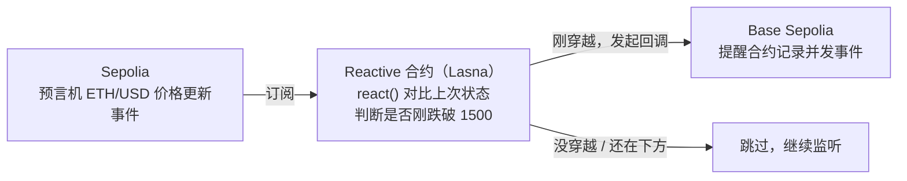

# 用例拆解卡：ETH 跌破 1500 美元时提醒我

**我的想法**：我不可能一直盯着 ETH 的价格看，但跌破 1500 美元这种关键位置我又不想错过。所以想做一个提醒：价格从上方跌破 1500 的那一刻，在链上记一条提醒，我就能第一时间知道。

## 1. 监听哪条链、哪个合约的什么事件？

监听 Ethereum Sepolia 上价格预言机合约的 ETH/USD 价格更新事件。价格的变化最先反映在这个合约的事件里，所以盯住它就等于盯住了价格本身。我的 Reactive 合约部署在 Lasna 上，在构造函数里订阅这个事件。

## 2. 满足什么条件时触发？

不是价格在 1500 以下就一直提醒，那样价格在附近横跳时会收到一堆重复提醒。我定的规则是：**只在价格从 1500 上方穿到下方那一刻提醒一次**；之后必须先涨回 1500 以上，再次跌破才算新的一次。

实现上，react() 不能只看当前价格，还要在合约里存一个状态，记住上一次价格在 1500 上方还是下方。这次在下方、上次在上方，才判定为「刚穿下来」，触发提醒；如果上次就已经在下方了，说明还在同一轮下跌里，直接跳过。

## 3. 在哪条链做什么动作？

触发后通过回调到 Base Sepolia，调用那边的提醒合约，记下这次提醒（跌破时的价格和时间）并发出一个提醒事件。这样整条链路是完整的跨链：源链出事件 → Reactive 判断 → 目标链执行，链上都能查到记录。

## 4. 不用 Reactive 我会怎么做？Reactive 简单在哪、代价是什么？

说实话，不用 Reactive 我最土的办法就是想起来的时候问一下 AI，或者自己打开行情看一眼。问题很明显：靠人想起来，忙起来或者睡一觉就漏了，而且看到的只是那一刻的价格，没人替我 24 小时站岗。再进阶一点就是自己写个程序在服务器上不停轮询价格，但要租服务器、要维护程序，真要发交易还得把私钥放服务器上，又多一层风险。

Reactive 简单在：逻辑写进合约部署上链之后，它就一直在那「站岗」，价格穿越的那一刻系统自动调用 react()，不用服务器，也不用托管私钥，执行记录全在链上可查。

代价是每次触发都要花钱：react() 烧合约里预充的 lREACT，回调到 Base Sepolia 还要付那边的 gas，合约欠费了就会停摆，所以要预充值。另外如果价格在 1500 附近反复穿越，就会反复提醒、反复扣费——这也是我第 2 题选「穿越才提醒」的原因，多少能挡掉一点无意义的重复触发。

## 流程简图

